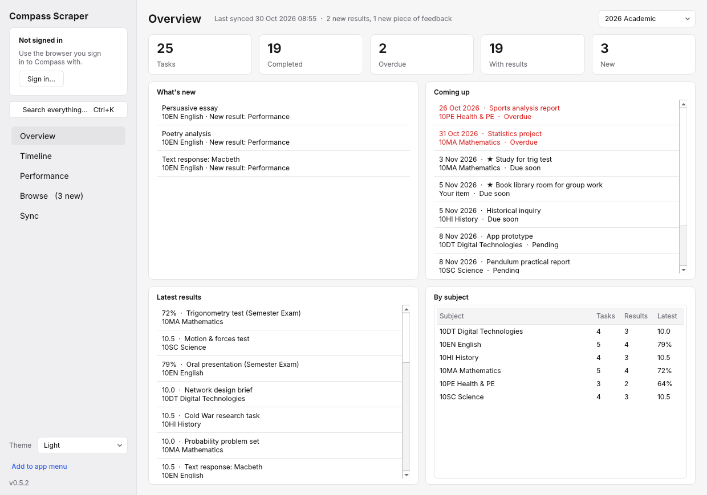
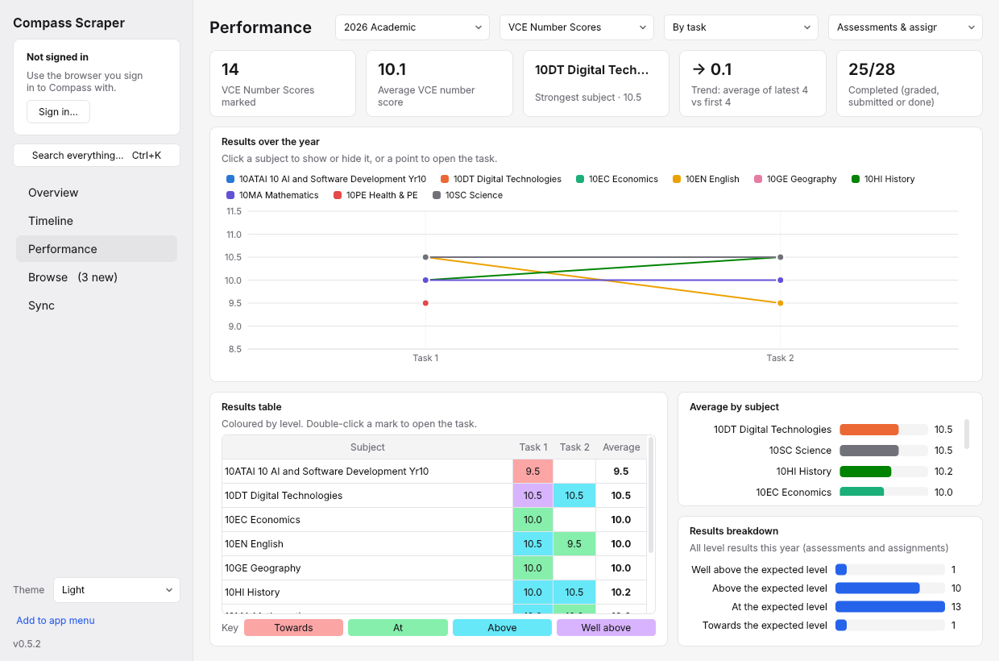
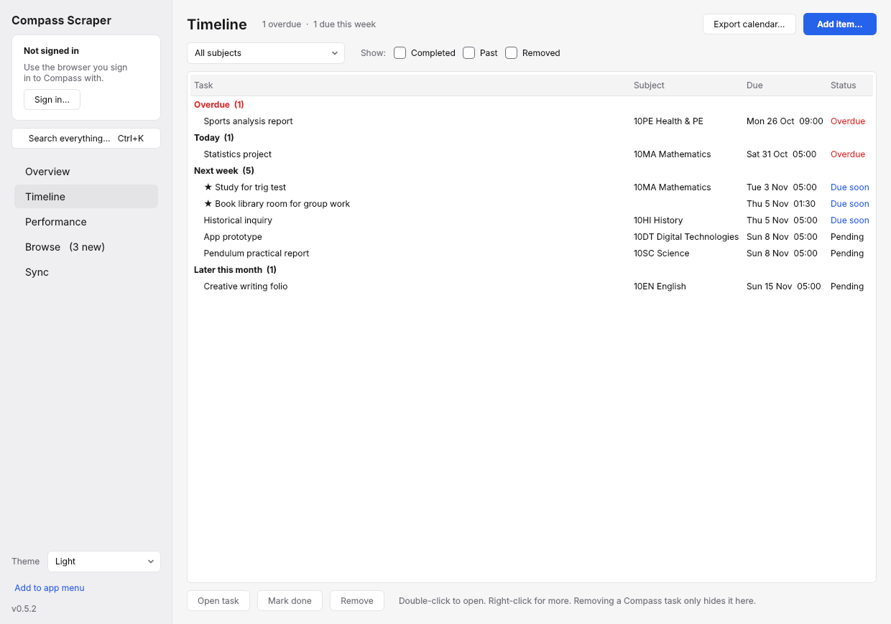
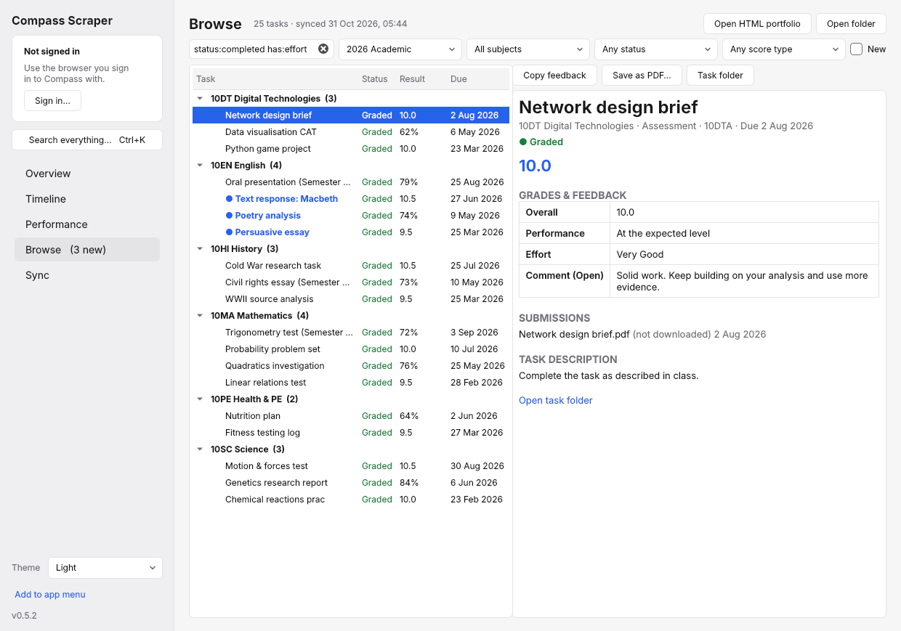
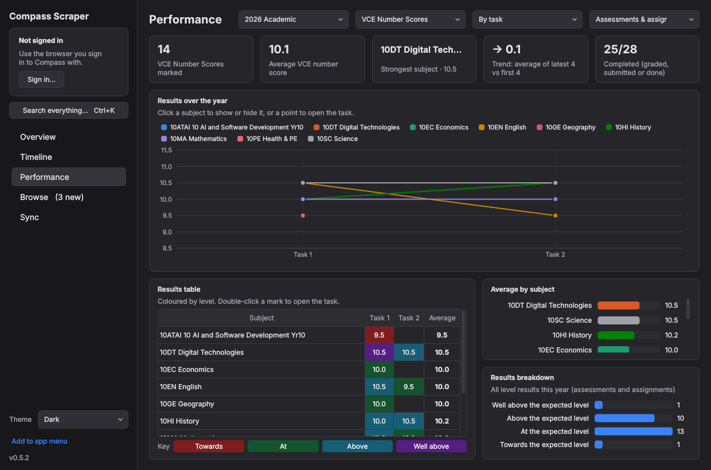

<div align="center">


# Compass Scraper

**Back up everything from your Compass Education learning tasks: grades, full teacher feedback, rubrics and files, in one click.**


<picture>
  <source media="(prefers-color-scheme: dark)" srcset="docs/overview-dark.png">
  
</picture>

</div>

---

Compass shows learning tasks 20 at a time, forgets your filters on every refresh, and hides the teacher's comment several clicks deep. Compass Scraper signs in using the browser you already use. It pulls every task through the same API the Compass website uses and saves all of it to a folder you keep: a portfolio you can search, print and take with you after you leave the school.

## Features

- **Everything in one place.** You get every grade row (subject grade, Performance, Effort) and the full **Comment (Open)** teacher feedback with its line breaks. Rubrics come with your awarded levels highlighted, along with task descriptions, attachments, your submissions and the teacher's response files.
- **Simple sign-in.** Sign in to Compass in Firefox, Chrome, Brave, Edge and so on as you normally would, CAPTCHA included, and the app picks up that session. You never type your password into it.
- **What's new.** Each sync flags new tasks, newly released results, new feedback, rubric marks, new files and changed due dates. Unread tasks get a blue dot until you open them.
- **Overview.** See what's new, what's overdue or coming up, your latest results and a per-subject summary at a glance.
- **Task status.** Every task is marked **Graded**, **Submitted**, **Done**, **Overdue**, **Due soon** or **Pending**. Tasks with a result or an uploaded file count as complete automatically, and you can mark the rest done yourself.
- **Master timeline.** One list of every due date, grouped into Overdue, Today, This week, Next week and Later. Add your own items (study sessions, reminders), mark things done, remove tasks you don't care about, and export everything to Google, Apple or Outlook Calendar as an `.ics` file.
- **Performance graphs.** For each academic year, the app graphs your Assessments and Assignments, each subject task by task (or by due date). Every marked task goes into exactly one category:
  - **VCE Number Scores:** number marks such as 9.5 or 10.0
  - **SACs:** percentage results
  - **Exams:** percentage results on tasks with "exam" in the name

  Percentages and number scores are never mixed. The page also has a results table like an achievement sheet, with each mark coloured Towards, At, Above or Well above level. It shows your average per subject and a breakdown of every level result too.
- **Search and filters.** Results filter instantly as you type, by status, subject, year or score type. Use search filters like `status:overdue`, `has:rubric` or `subject:english`. **Ctrl+K** searches every task in every year from anywhere in the app. Copy a task's feedback, save it as a PDF, or open its folder.
- **Incremental syncs.** Re-syncing only downloads what's missing, so you can stop a sync at any time and resume it later.
- **Portable output.** The app builds a self-contained `index.html` dashboard, a printable page for each rubric, `data.json` and an optional ZIP of everything.
- **Comfortable to use.** It has light and dark themes (or follows your system), keyboard shortcuts, an optional sync when the app opens, and a Linux app-menu launcher.
- **Command line too.** The same engine is available as `compass-scraper` for scripting.

<table>
<tr>
<td></td>
<td></td>
</tr>
<tr>
<td></td>
<td></td>
</tr>
</table>

## Getting started

1. Download the app for your system from [**Releases**](../../releases/latest) and open it.
2. **Sign in to Compass in your normal browser.** Firefox is the most reliable choice.
3. In the app, click **Sign in…**, pick that browser and click **Use my browser's session**.
4. Open **Sync**, tick the years you want and click **Sync now**.
5. Use **Overview**, **Timeline**, **Performance** and **Browse** to look through everything. Your files are in `~/Documents/Compass Portfolio` by default.

> Sign-in not working? Click **Diagnose…** in the sign-in window. It reports cookie *names* only, never their values. As a fallback, use **Paste cookie instead…**: in Compass, press F12, open Network, reload, click any request and copy the `Cookie` header.

## Keyboard shortcuts

| Keys | Action |
|---|---|
| <kbd>Ctrl</kbd>+<kbd>K</kbd> | Search everything |
| <kbd>Ctrl</kbd>+<kbd>1</kbd> … <kbd>5</kbd> | Overview / Timeline / Performance / Browse / Sync |
| <kbd>Ctrl</kbd>+<kbd>N</kbd> | Add a timeline item |
| <kbd>Ctrl</kbd>+<kbd>R</kbd> or <kbd>F5</kbd> | Sync now |
| <kbd>Ctrl</kbd>+<kbd>F</kbd> | Search in Browse |

### Search filters

Type these into any search box, combined with normal words. For example: `essay status:graded subject:english`.

| Filter | Matches |
|---|---|
| `status:` | `graded`, `submitted`, `done`, `overdue`, `due` (due soon), `pending`, `completed`, `todo`, `new` |
| `subject:` `year:` `category:` | part of the subject, year or category name, e.g. `subject:math`, `year:2025` |
| `has:` | `rubric`, `feedback`, `submission`, or a grade row such as `has:effort` |
| `"…"` | an exact phrase, e.g. `"running man"` |

## What you get

```
Compass Portfolio/
├── index.html            searchable dashboard (open in any browser, works offline)
├── data.json             everything, machine-readable
├── .planner.json         your timeline items and "done" marks
├── .seen.json            which changes you've already looked at
└── 2025 Academic/
    └── 9DIG Digital Technologies/
        └── CAT 1 - Infographic [29711]/
            ├── task.json                         grades, full feedback, rubric, description
            ├── Rubric - 9DIG CAT 1 Infographics.html
            ├── Attachments/
            ├── Submissions/
            └── Teacher responses/
```

## Command line

```bash
uv run compass-scraper                              # every year, reads the session from any browser
uv run compass-scraper --browser Firefox --year 2025
uv run compass-scraper --list-years
```

| Option | What it does |
|---|---|
| `--year 2025` | Only that academic year (repeatable). The default is every year. |
| `--out FOLDER` | Where to write the portfolio. |
| `--no-files` | Skip file downloads (grades, feedback and rubrics only). |
| `--no-zip` | Don't build the ZIP. |
| `--include-hidden` | Include tasks Compass marks as hidden. |
| `--browser NAME` | Firefox, Chrome, Chromium, Brave, Edge, Vivaldi, Opera or LibreWolf. |
| `--cookie "…"` | Use a Cookie header copied from DevTools. |
| `--user-id N` | Your Compass user ID, if it can't be detected. |
| `--relogin` / `--logout` | Refresh or delete the saved session. |
| `--diagnose` | Print a sign-in diagnostic report (no cookie values). |
| `--host` | Another school's Compass address (the default is `auburnhs-vic.compass.education`). |
| `--install-desktop` | Add the app to your Linux application menu. |

## Building standalone apps

PyInstaller builds for the OS it runs on, so build each platform on that platform:

```bash
uv run --with pyinstaller pyinstaller --noconfirm --windowed --name "Compass Scraper" \
  --collect-submodules compass_scraper launch_gui.py
```

The result is in `dist/`. To build Windows, macOS and Linux versions together, run the **Build desktop app** workflow from the Actions tab, or push a tag like `v0.4.0`. Each build is attached to the workflow run.

Notes for each platform:

- **Windows:** recent Chrome and Edge versions lock their cookies, so use Firefox or **Paste cookie instead…**.
- **macOS:** the build is unsigned, so the first time you open it, right-click it and choose **Open**.

## How it works

Compass is an ASP.NET site with a JSON API under `/Services/*.svc`. The app calls that API directly with your browser's session cookies. It mapped the API with a browser-console site mapper first.

| Data | Endpoint |
|---|---|
| Academic years | `ReferenceDataCache.svc/GetAllAcademicGroups` |
| Tasks, results, comments, file lists | `LearningTasks.svc/GetAllLearningTasksByUserId` (paged) |
| Grade labels | `ReferenceDataCache.svc/GetGradingSchemesForLearningTasks` |
| Categories | `LearningTasks.svc/GetAllTaskCategories` |
| Rubrics | `Rubrics.svc/GetRubricsByWikiNodeIds` |
| Attachments | `FileAssets.svc/DownloadFile` |
| Submissions / teacher responses | `FileDownload/FileRequestHandler?FileDownloadType=2 / 4` |

<details>
<summary>Project layout</summary>

```
compass_scraper/
├── gui.py        main window, sign-in dialog, Sync page
├── overview.py   Overview page
├── browse.py     Browse page, PDF export
├── theme.py      light / dark themes
├── auth.py       reading browser sessions, saved sessions, diagnose
├── client.py     Compass API client
├── model.py      turns API data into clean task records
├── scrape.py     the sync: collect, download, write outputs
├── changes.py    what's-new tracking between syncs
├── insights.py   task status, score scale, planner, search filters, calendar export
├── timeline.py   Timeline page
├── performance.py  Performance page
├── charts.py     the graphs
├── quickfind.py  Ctrl+K search
├── report.py     HTML dashboard and rubric pages
├── desktop.py    Linux launcher
└── cli.py        command line
```
</details>

## Privacy and security

- Your password never touches this app. It reuses the session from your own browser.
- The saved session lives in `~/.compass-scraper/` with owner-only permissions. **Sign out** deletes it.
- Everything stays on your computer. The app only talks to your school's Compass server.
- **Never commit or share** `~/.compass-scraper/` or a pasted cookie. Either one gives access to your Compass account until the session expires.

## Development

```bash
uv run --extra dev pytest
QT_QPA_PLATFORM=offscreen uv run --extra dev pytest   # also runs the headless GUI test
```

The tests run full syncs, change detection and the GUI against a local fake Compass server that uses the real field names.

## Disclaimer

This is an unofficial personal tool. It isn't affiliated with or endorsed by Compass Education. Use it only on your own account, follow your school's IT policies, and keep request volumes reasonable.
